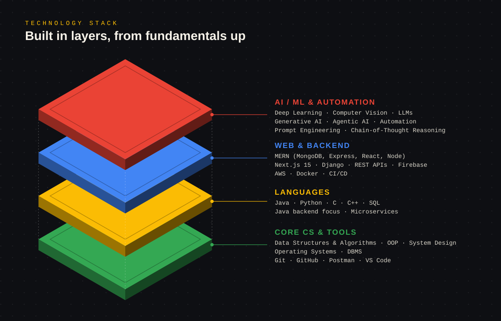

## About me

I'm **Meghna Chatterjee**, a Full Stack & Machine Learning developer with a Java backend focus. I'm studying B.Tech in Computer Science & Engineering (AI & ML) at Dr. B. C. Roy Engineering College, Durgapur, where I'm the department topper (rank 1, CGPA 9.5/10).

My journey in technology has been driven by curiosity, experimentation, and the desire to build things that solve real problems. I started with programming fundamentals and gradually moved into software development, machine learning, artificial intelligence, and system architecture. Today I work at the intersection of **Applied AI, Full Stack Engineering, and AI Infrastructure & Security**.

I don't want to learn technology only in theory. I like turning ideas into working products, competing in hackathons, collaborating with other developers, and learning from real engineering problems.

**What I do right now**
- Founder & Project Lead at **Styme**, building AI tutoring agents and the platform around them
- Lead of **Google Developer Groups on Campus, BCREC**
- Building **Scyvera**, an AI agent contract governance and runtime enforcement framework
- Working on Java backends, APIs and microservices
- Solving DSA problems and competing on LeetCode and Codeforces

[GitHub](https://github.com/fun-geek) · [LinkedIn](https://www.linkedin.com/in/meghna-chatterjee-b80462325/) · [LeetCode](https://leetcode.com/chatterjeemeghna) · [Codeforces](https://codeforces.com/profile/Meghna98) · [chatterjeemeghna16@gmail.com](mailto:chatterjeemeghna16@gmail.com)

---

## Engineering domains

| Domain | What I work on |
|---|---|
| **Applied AI** | Machine learning, deep learning, computer vision, LLM applications, generative AI, practical AI-powered software |
| **Full Stack & Backend** | MERN stack, Next.js 15, Django REST Framework, Java backends, REST APIs, microservices, Firebase |
| **AI Infrastructure & Security** | Agent governance, agent contracts, contract validation, runtime enforcement, auditability, controlled agent operations |
| **Algorithmic Engineering** | Data structures and algorithms, competitive programming, optimization, complexity analysis |

---

## Technology stack

---

## Measured impact

---

## Experience

### Founder & Project Lead, Styme
*Sep 2025 – Present*

- Architected a real-time machine learning framework using the **Gemini API** to deploy automated tutoring agents, reducing response latency by **25%**.
- Led a cross-functional development team through the full software development lifecycle, migrating core infrastructure to the **MERN stack** and boosting scalability by **40%**.
- Delivered backend services with **Django REST Framework** and **Java** to securely handle data for **500+ student profiles**.

### Full Stack Developer Intern, IndiQuant
*Oct 2025 – Dec 2025*

- Engineered secure, high-throughput REST APIs with **Node.js** and **Express.js**, reducing endpoint processing overhead by **20%**.
- Implemented full-stack applications integrating **MongoDB** schemas and secure state-management logic across the stack.
- Managed client-side routing and asynchronous service layers with **React.js**, improving API connectivity reliability by **95%**.

### GDG on Campus Lead, Google Developer Groups, BCREC
*Aug 2025 – Present*

- Directed operational strategy for full-stack development tracks, raising student engagement by **35%** campus-wide.
- Organized **10+ national-level tech events** and multi-tiered hackathons for a community network of **500+ members**.

---

## Projects

### Real-Time Deepfake Detection System
`Python` `TensorFlow` `PyTorch` `OpenCV` · [Live demo](https://deepfake-realtime.vercel.app)

- End-to-end deepfake verification system built on **ResNet** and **InceptionNet**, detecting spatial-temporal anomalies with **90% accuracy**.
- OpenCV-driven preprocessing pipeline for live-stream frames, sustaining inference latency under **50 ms**.

### AI-Powered Autonomous Drone System
`Python` `OpenCV` `Deep Learning` `Sensor Fusion`

- Real-time computer vision subsystem for object detection and tracking, improving bounding-box inference by **15%**.
- Custom **YOLO** localization models trained across **5+** variable test environments to improve target-marker detection and spatial navigation accuracy.

### College Club Discovery Platform
`React.js` `Node.js` `Express.js` `MongoDB` · [Live demo](https://campus-hero.vercel.app)

- Multi-tier club ecosystem with structured REST APIs, **JWT authentication** and full-stack CRUD tools.
- Optimized MongoDB collections and indexing schemas, accelerating cross-collection data fetching by **30%**.

### Scyvera: AI Agent Contract Governance & Runtime Enforcement Framework
[Repository](https://github.com/Skull-boy/agent-contracts)

As AI agents interact with tools, APIs, external services and other systems, controlling their behavior becomes an engineering challenge. Scyvera explores a contract-driven approach: instead of only instructing agents what to do, it defines what they are *permitted* to do.

- Structured agent contracts and contract validation
- Semantic analysis of agent policies
- Runtime policy enforcement with default-deny authorization
- Approval-controlled operations
- Auditability and governance for secure agent integrations

### More projects
[SugarSense AI](https://github.com/fun-geek/SugarSense) (local-first health data tracking and analytics) · [DeepShield AI](https://github.com/fun-geek/Deepshield.ai) (AI security) · [StudyBuddyy](https://github.com/fun-geek/StudyBuddyy) (student productivity) · [Divine Astayama](https://github.com/fun-geek/Divine_Astayama) (image-based particle visualization) · [DSA Adventure](https://github.com/fun-geek/DSAAventure) (algorithmic problem-solving)

---

## Hackathons

Hackathons taught me to think under pressure, collaborate with a team, approach unfamiliar problems, and turn ideas into working prototypes.

- **4× Hackathon Winner**
- **Hack Zenith**: winner, with the PseudoNoma project
- **Hack Maze (campus)**: first place
- **Horizon 2025**: Certificate of Winner
- **Smart India Hackathon (SIH)**: internal finalist, with the QVeritas project

---

## Algorithmic thinking

150+ problems solved on competitive programming platforms ([LeetCode](https://leetcode.com/chatterjeemeghna), [Codeforces](https://codeforces.com/profile/Meghna98)).

Searching and sorting · Binary search · Recursion and backtracking · Trees and graphs · Dynamic programming · Greedy algorithms · Complexity analysis

---

## Timeline

---

## Current focus

| Direction | Focus |
|---|---|
| Applied AI | Deep learning, computer vision, LLM applications |
| AI infrastructure | Agent contracts, governance, runtime enforcement |
| Security | Policy architecture and controlled agent operations |
| Software engineering | Java backend, APIs, microservices |
| Algorithms | DSA, competitive programming, optimization |

---

## Education & achievements

**B.Tech, Computer Science & Engineering (AI & ML)**
Dr. B. C. Roy Engineering College, Durgapur, West Bengal · 2024 – 2028 · CGPA 9.5/10

-  Topper, CSE (AI & ML)
- Smart India Hackathon (SIH) Finalist
- 4× Hackathon Winner
- 7× Open Source Contributor
- 150+ Data Structures & Algorithms problems solved
- GDG on Campus Lead: 10+ national-level events, 500+ community members

---

## Engineering philosophy

I don't believe in stopping at an idea. I believe in understanding the problem, building the solution, testing it, and making it better.

**Never I lose. Either I win or I learn.**

---

## Let's connect

Open to collaboration on applied AI, AI infrastructure, open-source projects, and challenging software problems.

[GitHub](https://github.com/fun-geek) · [LinkedIn](https://www.linkedin.com/in/meghna-chatterjee-b80462325/) · [LeetCode](https://leetcode.com/chatterjeemeghna) · [Codeforces](https://codeforces.com/profile/Meghna98) · [Email](mailto:chatterjeemeghna16@gmail.com)
