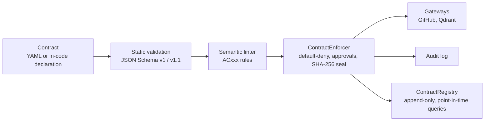

  <a href="https://github.com/fun-geek"><b>GitHub</b></a> &nbsp;·&nbsp;
  <a href="https://www.linkedin.com/in/meghna-chatterjee-b80462325"><b>LinkedIn</b></a> &nbsp;·&nbsp;
  <a href="https://leetcode.com/chatterjeemeghna"><b>LeetCode</b></a> &nbsp;·&nbsp;
  <a href="https://codeforces.com/profile/Meghna98"><b>Codeforces</b></a> &nbsp;·&nbsp;
  <a href="mailto:chatterjeemeghna16@gmail.com"><b>Email</b></a>

B.Tech CSE (AI &amp; ML) · Dr. B. C. Roy Engineering College · 2024–2028 · Durgapur, West Bengal, India

<!-- TODO (optional): add Portfolio and CodeChef links to the nav row above once the URLs are confirmed. -->

&nbsp;

## Engineering Philosophy

I build and study intelligent systems from three directions, and I try to understand each one well enough to validate it, not just call it.

<table>
  <tr>
    <td width="33%" valign="top">
      <b>01 · Applied AI</b>  
      Machine learning, deep learning, computer vision and LLMs, connected to practical software rather than left in notebooks.
    </td>
    <td width="33%" valign="top">
      <b>02 · AI Infrastructure &amp; Security</b>  
      Governance, validation, authorization and runtime enforcement of AI agent behavior. An emerging area that I explore through open-source work.
    </td>
    <td width="33%" valign="top">
      <b>03 · Algorithmic Engineering</b>  
      Data structures, algorithms and competitive programming (primarily C++) as the foundation under everything else.
    </td>
  </tr>
</table>

Underneath sits a software engineering base: full-stack development (MERN), backend interests and a project-first habit of shipping small, working things.

&nbsp;

## 01 — Applied AI Engineering

*Building intelligent applications that connect machine learning techniques with practical software engineering.*

| Domain | Focus | Tooling |
|:--|:--|:--|
| Machine / Deep Learning | Neural networks, model training and evaluation | `Python` `PyTorch` `TensorFlow` `Scikit-learn` |
| Computer Vision | Real-time vision pipelines | `OpenCV` `NumPy` |
| LLMs &amp; Generative AI | AI-powered applications, intelligent automation | `Python` |
| Data handling | Preparation and analysis | `Pandas` `NumPy` |

> These are the areas I study and build in. Shipped repositories are listed under [Selected Work](#selected-work).

&nbsp;

## 02 — AI Infrastructure &amp; Security

*Engineering the governance, validation, authorization and runtime control mechanisms required for accountable AI agent systems.*

**Areas of focus:** agent governance · contract validation · semantic linting · default-deny enforcement · approval boundaries · audit logging · secure agent integrations

This is a domain I am actively learning and contributing to, not one where I claim finished, production-scale systems.

### Featured: Scyvera

**AI agent contract governance and runtime enforcement.** An open-source Python framework by [Shinjan Das](https://github.com/Skull-boy) for declaring what an agent can do, what needs human approval, and what it must never do, then enforcing that at runtime.

> **My role:** credited code contributor. I contributed a workflow for structured AI document generation (JSON-first LLM contracts, validation-driven execution, self-correcting retries and automated PDF delivery), as recorded in the project's [CONTRIBUTORS.md](https://github.com/Skull-boy/agent-contracts/blob/main/CONTRIBUTORS.md).

**The problem.** MCP and A2A standardize how agents talk to tools and to each other. They do not define the operational boundary an agent should run inside. A policy that only lives in documentation is not enforced. Scyvera's premise is that the boundary should be declared up front, checked statically, enforced at runtime and provable afterward.

**How the architecture works** (as documented in the project README):

| Layer | What it does |
|:--|:--|
| **Validation and linting** | Checks contracts against bundled JSON Schemas, then applies semantic rules such as unbounded write permissions and irreversible actions without an approval boundary. |
| **Runtime enforcer** | `ContractEnforcer` gates Python calls with default-deny semantics. Undeclared actions raise a violation error, and actions needing approval raise a pending-approval error. Contracts are sealed with a SHA-256 hash and an audit trail is kept. |
| **Gateways** | Credentials and raw API clients live privately inside gateway classes, so external calls cannot bypass the gate. A CI check fails the build if raw clients are imported elsewhere. |
| **Contract registry** | A versioned, append-only store that can answer which contract governed an agent at a given moment. |
| **Audit scan** | `scyvera audit` scans a repository and drafts a starting contract from what it finds. |

**What makes it interesting.** It treats agent permissions as a verifiable artifact rather than a prompt, and it is candid about limits. The project documents what it does *not* guarantee (for example, gate bypass at un-gated call sites and pre-load file tampering), and several items such as a hash-chained registry sit on its roadmap rather than in the code.

[**View the repository →**](https://github.com/Skull-boy/agent-contracts) &nbsp;·&nbsp; [PyPI package](https://pypi.org/project/scyvera/)

&nbsp;

## 03 — Algorithmic Thinking &amp; Problem Solving

I practice data structures and algorithms regularly, mainly in C++, and use contests to keep the fundamentals sharp.

**Areas:** arrays and strings · searching and sorting · binary search · recursion and backtracking · linked lists · stacks and queues · trees · graphs · greedy · dynamic programming · hashing

### Algorithmic Performance

<table>
  <tr>
    <td width="50%" valign="top">
      <b>LeetCode</b> 
      <code>chatterjeemeghna</code>  
      <a href="https://leetcode.com/chatterjeemeghna">Open profile →</a>
    </td>
    <td width="50%" valign="top">
      <b>Codeforces</b> 
      <code>Meghna98</code>  
      <a href="https://codeforces.com/profile/Meghna98">Open profile →</a>
    </td>
  </tr>
</table>

<!--
OPTIONAL LIVE LEETCODE CARD. Test the URL in a browser before enabling it, and keep it commented out if it fails.

CODECHEF CARD. Add once your CodeChef username is confirmed:
<td><b>CodeChef</b> <code>YOUR_HANDLE</code>  <a href="https://www.codechef.com/users/YOUR_HANDLE">Open profile →</a></td>
-->

&nbsp;

## Selected Work

| Project | What it is | Stack |
|:--|:--|:--|
| [**Scyvera**](https://github.com/Skull-boy/agent-contracts) *(contributor)* | Agent contract governance and runtime enforcement framework. I contributed a structured AI document-generation workflow. | Python |
| [**SecureHelix**](https://github.com/fun-geek/SecureHelix) | DNA-lock concept with biometric authentication: it asks for a fingerprint and a DNA sequence and verifies both before granting access. | CSS |
| [**RockPaperScissor**](https://github.com/fun-geek/RockPaperScissor) | Browser game. | JavaScript |
| [**SCT_WD_3**](https://github.com/fun-geek/SCT_WD_3) · [**SCT_WD_4**](https://github.com/fun-geek/SCT_WD_4) | Web development task projects. | JavaScript |

<!--
ADD YOUR STRONGEST WORK HERE once you have confirmed the repository URLs. Suggested rows:
| [**Deepfake Detection System**](URL) | one-line problem statement | stack |
| [**Autonomous Drone System**](URL) | ... | ... |
| [**SugarSense AI**](URL) | ... | ... |
| [**StudyBuddyy / Mind Care**](URL) | ... | ... |
| [**DSAAventure**](URL) · [**DSA Forest Solver**](URL) | ... | C++ |
Only link repositories under your own account, or credit the true owner as done for Scyvera.
-->

&nbsp;

## Experience

| Role | Organization | Period |
|:--|:--|:--|
| Founder &amp; Project Lead | **STYME** | Sep 2025 – Present |
| Full Stack Developer Intern | **INDIQUANT** | Oct 2025 – Dec 2025 |
| GDG on Campus Lead | **Google Developer Groups, BCREC** | Leadership role |

<!-- TODO: add 1-2 factual bullets per role from your resume (what you built, owned or shipped). No invented metrics. -->

&nbsp;

## Technology

| Category | Technologies |
|:--|:--|
| **Languages** | `Java` `Python` `C` `C++` `SQL` |
| **Applied AI** | Machine Learning · Deep Learning · Computer Vision · LLMs · Generative AI |
| **AI Infrastructure &amp; Security** | Agent governance · Contract validation · Runtime enforcement · Policy architecture |
| **Backend &amp; Full Stack** | `Node.js` `Express.js` `React.js` `MongoDB` `Django` · REST APIs |
| **Development &amp; Infrastructure** | `Git` `GitHub` `Docker` `Postman` `VS Code` |

&nbsp;

## Open Source &amp; Community

- **Scyvera** — credited code contributor ([CONTRIBUTORS.md](https://github.com/Skull-boy/agent-contracts/blob/main/CONTRIBUTORS.md)).
- **GDG on Campus, BCREC** — community and event leadership.
- **GitHub achievements:** Pull Shark · YOLO · Quickdraw, shown on my [profile](https://github.com/fun-geek).

&nbsp;

## Achievements

- Smart India Hackathon — Finalist
- Department Topper
- Hackathon participation and technical community leadership through GDG on Campus

<!-- TODO: add the year / edition next to each item, taken from your resume. -->

&nbsp;

## GitHub Activity

  
  &nbsp;
  

<!-- If either image fails to load, delete that  line. The README reads fine without them. -->

&nbsp;

## Current Focus

*Directions I am working toward, separate from the finished projects above.*

| Track | Exploring |
|:--|:--|
| **Applied AI** | Deep learning · Computer vision · LLM engineering · Intelligent applications |
| **AI Infrastructure &amp; Security** | Agent governance · Contract-driven architecture · Runtime policy enforcement · Secure agent systems |
| **Algorithmic Engineering** | DSA · Competitive programming · Algorithm optimization |
| **Software Engineering** | Java backend · Microservices · System design · Scalable backend systems |

&nbsp;

<a href="https://github.com/fun-geek">GitHub</a> &nbsp;·&nbsp;
<a href="https://www.linkedin.com/in/meghna-chatterjee-b80462325">LinkedIn</a> &nbsp;·&nbsp;
<a href="https://leetcode.com/chatterjeemeghna">LeetCode</a> &nbsp;·&nbsp;
<a href="https://codeforces.com/profile/Meghna98">Codeforces</a> &nbsp;·&nbsp;
<a href="mailto:chatterjeemeghna16@gmail.com">chatterjeemeghna16@gmail.com</a>

 

<i>Building intelligent systems. Engineering the infrastructure that keeps them accountable.</i>

