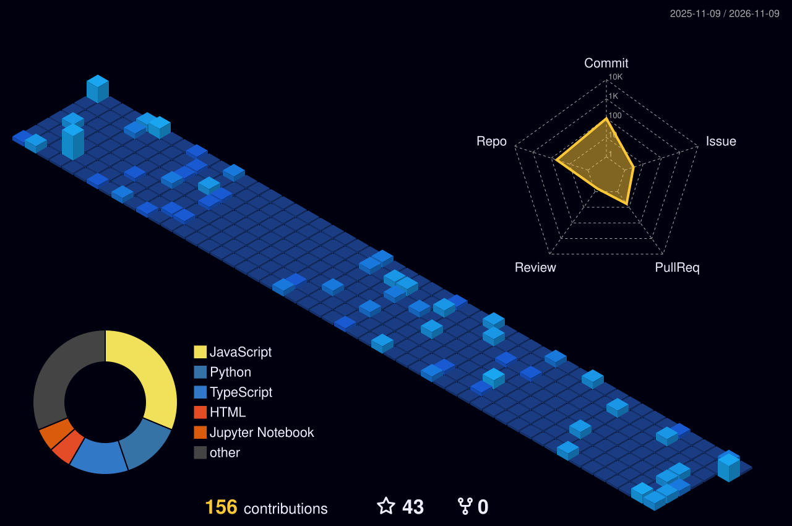
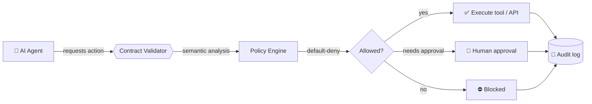

<div align="center">


<a href="https://github.com/fun-geek/fun-geek">
  
</a>

<br/>

<a href="https://github.com/fun-geek"></a>
<a href="https://www.linkedin.com/in/meghna-chatterjee-b80462325/"></a>
<a href="https://leetcode.com/chatterjeemeghna"></a>
<a href="https://codeforces.com/profile/Meghna98"></a>
<a href="mailto:chatterjeemeghna16@gmail.com"></a>

<br/><br/>


</div>

<br/>

## 🧊 `> whoami`

```ts
const meghna = {
  role:      "Full Stack & Machine Learning Developer",
  studying:  "B.Tech CSE (AI & ML) @ Dr. B. C. Roy Engineering College",
  cgpa:      9.5,                       // Department Topper, Rank 1
  leads:     ["Styme", "GDG on Campus BCREC"],
  buildsWith:["Java", "Python", "Node.js", "React", "PyTorch", "TensorFlow"],
  obsessedWith: ["AI agent governance", "computer vision", "clean backends"],
  motto:     "Never I lose — either I win or I learn.",
};
```

<table>
<tr>
<td width="25%" align="center"><h3>🧠<br/>Applied AI</h3><sub>Deep learning · Computer vision · LLMs · Agentic AI</sub></td>
<td width="25%" align="center"><h3>⚙️<br/>Backend</h3><sub>Java · Node.js · Django REST · Microservices</sub></td>
<td width="25%" align="center"><h3>🛡️<br/>AI Security</h3><sub>Agent contracts · Runtime enforcement · Governance</sub></td>
<td width="25%" align="center"><h3>🧩<br/>Algorithms</h3><sub>150+ DSA problems · Competitive programming</sub></td>
</tr>
</table>

---

## 🌆 My Contribution City (3D)

<div align="center">

<picture>
  <source media="(prefers-color-scheme: dark)" srcset="profile-3d-contrib/profile-night-view.svg">
  <source media="(prefers-color-scheme: light)" srcset="profile-3d-contrib/profile-green-animate.svg">
  
</picture>

<sub>Every building is a day of commits. Rebuilt automatically every night.</sub>

</div>

---

## 🛰️ Flagship: SCYVERA

> **AI Agent Contract Governance & Runtime Enforcement Framework**
> *Moving beyond telling agents what to do, toward defining what they are permitted to do.*



| Layer | What it does |
|---|---|
| **Agent contracts** | Structured definitions of capabilities and constraints |
| **Validation** | Contract validation and semantic analysis |
| **Enforcement** | Runtime policy enforcement with default-deny authorization |
| **Approvals** | Approval-controlled sensitive operations |
| **Audit** | Traceability and accountability for every action |

[](https://github.com/Skull-boy/agent-contracts)

---

## 🚀 Projects

<table>
<tr>
<td width="50%" valign="top">

### 👁️ Real-Time Deepfake Detection
ResNet + InceptionNet pipeline that catches spatial-temporal anomalies.

- **90%** detection accuracy
- **< 50 ms** inference on live-stream frames (OpenCV pipeline)

`Python` `TensorFlow` `PyTorch` `OpenCV`

[**Live demo →**](https://deepfake-realtime.vercel.app)

</td>
<td width="50%" valign="top">

### 🚁 AI-Powered Autonomous Drone
Real-time computer-vision subsystem for detection and tracking.

- Custom **YOLO** models trained in **5+** environments
- **15%** better bounding-box inference

`Python` `OpenCV` `Deep Learning` `Sensor Fusion`

</td>
</tr>
<tr>
<td width="50%" valign="top">

### 🏛️ College Club Discovery Platform
Multi-tier club ecosystem with JWT auth and full CRUD tooling.

- **30%** faster cross-collection fetches via index tuning

`React` `Node.js` `Express` `MongoDB`

[**Live demo →**](https://campus-hero.vercel.app)

</td>
<td width="50%" valign="top">

### 🧪 More builds
- [SugarSense AI](https://github.com/fun-geek/SugarSense): local-first health analytics
- [StudyBuddyy](https://github.com/fun-geek/StudyBuddyy): student productivity app
- [DeepShield AI](https://github.com/fun-geek/Deepshield.ai): AI security project
- [Divine Astayama](https://github.com/fun-geek/Divine_Astayama): particle visualization
- [DSA Adventure](https://github.com/fun-geek/DSAAventure): algorithm practice

</td>
</tr>
</table>

---

## 💼 Experience

```text
2025 ─────────────────────────────────────────────────────────────▶ now
  │
  ├── Aug 2025 ▸ GDG on Campus Lead ............ BCREC          (ongoing)
  ├── Sep 2025 ▸ Founder & Project Lead ........ Styme          (ongoing)
  └── Oct–Dec  ▸ Full Stack Developer Intern ... IndiQuant
```

<details open>
<summary><b>🧑‍🚀 Founder & Project Lead · Styme</b> <sub>(Sep 2025 – Present)</sub></summary>
<br/>

- Architected a real-time ML framework on the **Gemini API** for automated tutoring agents: **25% lower latency**
- Led a cross-functional team through the full SDLC; migrated core infrastructure to **MERN** for **40% better scalability**
- Built **Django REST** and **Java** backend services securely handling **500+ student profiles**

</details>

<details>
<summary><b>💻 Full Stack Developer Intern · IndiQuant</b> <sub>(Oct – Dec 2025)</sub></summary>
<br/>

- Engineered secure REST APIs in **Node.js / Express**: **20% less endpoint overhead**
- Integrated **MongoDB** schemas with secure state-management across the stack
- Managed routing and async service layers in **React**: **95% better API connectivity reliability**

</details>

<details>
<summary><b>🌐 GDG on Campus Lead · BCREC</b> <sub>(Aug 2025 – Present)</sub></summary>
<br/>

- Directed full-stack tracks, raising campus-wide engagement by **35%**
- Organized **10+ national-level events** and multi-tier hackathons for **500+ members**

</details>

---

## 🧰 Tech Arsenal

<div align="center">

| | |
|:--|:--|
| **Languages** |  |
| **AI / ML** |  |
| **Web & Backend** |  |
| **Cloud & Tools** |  |

<sub>LLMs · Prompt Engineering · Chain-of-Thought · Agentic AI · Generative AI · CI/CD · System Design · OOP · OS · DBMS</sub>

</div>

---

## 🏆 Trophy Room

<div align="center">

| 🥇 | 🎯 | 🎓 | 🧩 |
|:--:|:--:|:--:|:--:|
| **4× Hackathon Winner**<br/><sub>Hack Zenith · Hack Maze Campus</sub> | **SIH Internal Finalist**<br/><sub>Smart India Hackathon</sub> | **Department Topper**<br/><sub>CSE (AI & ML) · 9.5 CGPA</sub> | **150+ DSA Solved**<br/><sub>LeetCode · Codeforces</sub> |

</div>

[](https://leetcode.com/chatterjeemeghna)

---

## 🎓 Education

**Dr. B. C. Roy Engineering College**, Durgapur, West Bengal
B.Tech in Computer Science & Engineering (AI & ML) · 2024 – 2028 · **CGPA 9.5 / 10**

---

## 📊 Stats

<div align="center">


<br/>


</div>

---

## 🤝 Let's Build Something

Open to collaboration on **applied AI**, **AI infrastructure**, **open source**, and hard backend problems.

<div align="center">

<a href="https://www.linkedin.com/in/meghna-chatterjee-b80462325/"></a>
<a href="mailto:chatterjeemeghna16@gmail.com"></a>


</div>
